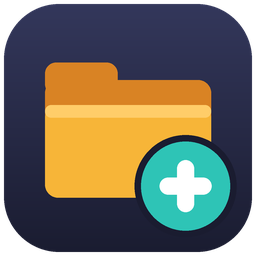

<p align="center">
  
</p>

<h1 align="center">Collect Files Plus — untuk After Effects</h1>

<p align="center">
  <a href="https://github.com/Kibo4aa/AE-collect-files/actions/workflows/ci.yml"></a>
  <a href="https://github.com/Kibo4aa/AE-collect-files/releases/latest"></a>
  <a href="LICENSE"></a>
</p>

Kumpulkan semua yang dibutuhkan project After Effects ke satu folder — **footage, font, dan plugin yang benar-benar dipakai** — langsung dari file `.aep`, **tanpa membuka After Effects**.

Collect Files bawaan AE hanya mengumpulkan footage. Aplikasi ini juga mencari font yang dipakai text layer dan file plugin pihak ketiga yang efeknya ada di project, jadi project bisa dipindah ke komputer lain, diarsipkan, atau dikirim ke teman tanpa "missing effect / missing font".

*English summary: [below](#english).*

## Fitur

- **Tanpa After Effects** — file `.aep` dibaca langsung (pakai [py_aep](https://github.com/forticheprod/py-aep)). AE tidak perlu dibuka, bahkan tidak perlu terinstall untuk collect footage.
- **Footage** — dicopy ke `(Footage)` dan project di-relink ke lokasi baru. Image sequence dicopy lengkap; footage yang hilang dilaporkan. Yang diubah hanya path, jadi layered PSD dan pengaturan footage lain tetap utuh.
- **Reduce Project (opsional)** — buang comp dan footage yang tidak dipakai comp pilihan.
- **Font** — font yang dipakai text layer dicari lewat nama PostScript di folder font Windows/macOS lalu dicopy ke `(Fonts)`. Font Adobe Fonts dilaporkan (aktifkan lagi lewat Creative Cloud).
- **Plugin, hanya yang dipakai** — yang dicopy hanya **file** plugin yang efeknya ada di project, bukan satu folder vendor (contoh: pakai 1 efek Boris FX → yang dicopy hanya `BCC_Blur.aex`, bukan seluruh Continuum).
  - Efek dikenali dari *match name*, bukan nama di layer, jadi efek yang di-rename (misalnya `A_kaca`, `a_paya`) tetap ketemu.
  - Efek yang dimatikan (ikon fx off) bisa dilewati.
  - Hanya comp yang dipilih (plus precomp di dalamnya) yang dibaca.
  - Daftar file plugin bisa dicentang atau dihapus centangnya sebelum dicopy.
- **Pseudo effect / PresetEffects.xml** — definisi efek buatan (biasanya dari preset pack) disalin ke `(PresetEffects)` lengkap dengan petunjuknya.
- **Laporan** — `<project>_report.txt` dan `<project>_daftar_efek.csv` (bisa dibuka Excel; berisi setiap efek di setiap layer beserta file plugin-nya).
- **Aman** — file `.aep` asli tidak pernah diubah. Kalau project hasil perlu disimpan ulang (relink/reduce), salinan aslinya disimpan di `(Backup)` dan project hasil dibaca ulang untuk dicek.
- **GUI + command line**, plus script **JSX** untuk dijalankan dari dalam After Effects ([`jsx/`](jsx/CollectFilesPlus.jsx)).

## Download

Buka **[Releases](https://github.com/Kibo4aa/AE-collect-files/releases/latest)**:

| Sistem | File | Cara jalan |
|---|---|---|
| Windows 10/11 (64-bit) | `CollectFilesPlus-v…-windows-x64.zip` | Extract, lalu jalankan `CollectFilesPlus.exe` |
| macOS Apple Silicon *(eksperimental)* | `CollectFilesPlus-v…-macos-arm64.zip` | Extract, lalu buka `CollectFilesPlus.app` |

- **Windows SmartScreen** bisa menampilkan peringatan karena exe belum punya code signing (berbayar): klik **More info → Run anyway**. Kalau ragu, jalankan dari source (lihat bawah); isinya sama persis dengan kode di repo ini.
- **macOS**: kalau muncul pesan *"app is damaged"*, jalankan sekali di Terminal: `xattr -dr com.apple.quarantine CollectFilesPlus.app`

## Cara pakai

1. Buka `CollectFilesPlus.exe`, klik **Pilih...** dan pilih file `.aep`. Bisa juga drag file `.aep` ke ikon `CollectFilesPlus.exe`.
2. Tab **1. Comp & opsi**: centang comp utama yang dipakai (render). Precomp di dalamnya ikut dibaca otomatis.
   - Pilihan awal: comp di Render Queue, kalau kosong comp yang aktif saat project disimpan, kalau tidak ada juga semua comp.
   - Tombol **Render Queue / Comp aktif / Semua / Kosongkan** untuk memilih cepat.
   - Pilih juga apa saja yang dikumpulkan.
3. Klik **Analisa**, lalu cek tab **Plugin / Font / Footage / Semua efek**. Di tab Plugin, hapus centang file yang tidak ingin dicopy. Baris bertanda **(perkiraan)** hanya tebakan, jadi tidak dicentang otomatis.
4. Pilih **Folder tujuan**, lalu klik **Collect**.

Hasilnya:

```
Proyek AMV_Collected/
├── Proyek AMV.aep              ← project yang sudah di-relink ke (Footage)
├── Proyek AMV_report.txt       ← laporan + cara pakai di komputer lain
├── Proyek AMV_daftar_efek.csv
├── (Footage)/
├── (Fonts)/
├── (Plugins)/
│   ├── MediaCore/...           ← struktur folder asli dipertahankan
│   └── AE Plug-ins/...
├── (PresetEffects)/            ← kalau ada pseudo effect dari PresetEffects.xml
├── (Presets)/                  ← kalau opsi preset dicentang
└── (Backup)/                   ← salinan .aep asli (kalau project disimpan ulang)
```

Di komputer tujuan: install font dari `(Fonts)`, copy plugin dari `(Plugins)` ke folder yang sama (lokasinya tertulis di laporan), lalu buka `.aep`-nya.

### Command line

Build Windows menyertakan `collect-files-plus.exe` (versi console) di folder yang sama.

```bat
collect-files-plus list-comps "D:\Edit\AMV.aep"
collect-files-plus analyze "D:\Edit\AMV.aep" --rq
collect-files-plus collect "D:\Edit\AMV.aep" -o "E:\Arsip" --comp "Main" --reduce
```

| Opsi | Arti |
|---|---|
| `--comp NAMA` (boleh berkali-kali) / `--rq` / `--all` | comp yang dibaca (default: Render Queue → comp aktif → semua) |
| `--no-footage`, `--no-fonts`, `--no-plugins` | jangan kumpulkan bagian itu |
| `--reduce` | buang comp & footage yang tidak dipakai |
| `--include-disabled` | ikutkan efek yang ikon fx-nya mati |
| `--support-files` | ikutkan file pendukung plugin (DLL/data di folder yang sama) |
| `--presets` | ikutkan animation preset (.ffx) yang namanya sama dengan efek yang di-rename |
| `--include-guesses` | ikut copy plugin hasil tebakan (perkiraan) |

## Cara kerja deteksi plugin

1. Setiap efek di layer menyimpan **match name**, yaitu ID internal (misalnya `BCC Directional Blr`) yang tidak berubah walaupun efeknya di-rename di layer.
2. Efek bawaan AE dikenali dari daftar resmi 313 match name (*After Effects Scripting Guide*), jadi tidak ikut dicopy.
3. Folder plugin AE dan MediaCore discan. Folder tambahan yang tercatat di `Plugin Loading.log` juga ikut, sedangkan folder yang namanya diapit kurung dilewati seperti di AE.
4. Dari setiap file `.aex` (Windows) atau `.plugin` (macOS), resource **PiPL** dibaca. Resource ini berisi daftar match name efek di dalam file itu. File yang cocok adalah file yang dicopy.
5. Kalau tidak ketemu, isi file plugin yang PiPL-nya tidak terbaca discan. Kalau masih belum ketemu, nama file ditebak, tapi hasil tebakan **tidak** dicentang otomatis.

## Batasan, baca dulu

- **Lisensi plugin.** Copy file plugin tidak ikut memindahkan lisensinya. Plugin berbayar (Boris FX, Red Giant/Maxon, Video Copilot, Sapphire, dll.) tetap butuh installer dan aktivasi resmi di komputer tujuan. Folder `(Plugins)` tetap berguna sebagai arsip dan daftar, dan untuk plugin gratis yang cukup dicopy.
- **Penyimpanan `.aep` masih eksperimental** (fitur tulis py_aep). Karena itu:
  - file asli tidak pernah ditimpa;
  - project hanya disimpan ulang kalau memang ada relink/reduce;
  - salinan asli ada di `(Backup)`;
  - hasilnya dibaca ulang untuk dicek.

  Kalau pengecekan gagal, laporan akan memberi tahu. Pakai file di `(Backup)` lalu relink manual, atau pakai script JSX.
- **Adobe Fonts** tidak dicopy (lisensi). Cukup aktifkan lagi lewat Creative Cloud. Font yang tidak terinstall di komputer ini juga tidak bisa dicopy, tapi tetap dilaporkan.
- **Versi AE**: kalau project dari versi AE yang sangat baru gagal dibaca, pakai script JSX dari dalam AE. File `.aepx` (XML) belum didukung.
- **`.aex` hanya jalan di Windows, `.plugin` hanya di macOS.**

## Script JSX (dari dalam After Effects)

[`jsx/CollectFilesPlus.jsx`](jsx/CollectFilesPlus.jsx) melakukan hal yang sama dari dalam AE, termasuk mengikuti Render Queue dan comp aktif.

1. Aktifkan dulu **Edit → Preferences → Scripting & Expressions → Allow Scripts to Write Files and Access Network**.
2. Jalankan lewat **File → Scripts → Run Script File…**.

## Jalankan dari source / build sendiri

**Windows, cara mudah:** install [Python 3.10+](https://www.python.org/downloads/) (centang *Add python.exe to PATH*), download repo ini (**Code → Download ZIP**), lalu double-click **`run.bat`**. Saat pertama kali, `run.bat` membuat `.venv` dan menginstall dependency. Untuk build exe sendiri: **`build_exe.bat`** → `dist\CollectFilesPlus\`.

**Manual:**

```bash
python -m venv .venv
.venv\Scripts\activate          # macOS/Linux: source .venv/bin/activate
pip install -e ".[dev]"
python -m collect_files_plus    # GUI (dengan argumen = CLI)
python -m pytest                # test
node jsx/tests/run_tests.js     # test script JSX
```

## Struktur repo

| Folder | Isi |
|---|---|
| `src/collect_files_plus/` | aplikasi: `project.py` (baca/relink .aep), `pipl.py` + `plugins.py` (deteksi plugin), `fonts.py`, `collector.py`, `report.py`, `gui.py`, `cli.py` |
| `tests/` | test pytest (memakai file .aep asli dan project buatan) |
| `jsx/` | script JSX untuk dijalankan di dalam After Effects, beserta test-nya |
| `packaging/` | spec PyInstaller, ikon, catatan rilis |
| `.github/workflows/` | CI (Windows/macOS/Linux) dan build + rilis otomatis saat push tag `v*` |

## Lisensi & kredit

MIT — lihat [LICENSE](LICENSE). Pustaka dan data pihak ketiga tercantum di [NOTICE.md](NOTICE.md).

After Effects adalah merek dagang Adobe Inc. Proyek ini independen dan tidak berafiliasi dengan Adobe.

---

## English

**Collect Files Plus** gathers everything an After Effects project needs into one folder — **footage, fonts, and only the plugin files whose effects are actually used** — by reading the `.aep` file directly, **without opening After Effects**.

- **Footage** is copied to `(Footage)` and the project is relinked to it. Only the paths are edited, so layered PSDs stay intact. Image sequences are copied in full.
- **Reduce Project** is optional.
- **Fonts** used by text layers are found by PostScript name and copied to `(Fonts)`. Adobe Fonts are reported only, not copied.
- **Plugins** are detected by effect *match name*, so renamed effect instances still match. Each `.aex`/`.plugin` file's **PiPL** resource is read, and only the files containing used effects are copied, never a whole vendor folder.
- Effects that are switched off can be skipped, and the scan is limited to the comps you pick plus their precomps.
- A text report and a CSV listing every effect on every layer are written alongside.
- The original `.aep` is never modified. The saved copy is re-read to verify it, and the original is kept in `(Backup)`.

Download the Windows build (or the experimental macOS build) from [Releases](https://github.com/Kibo4aa/AE-collect-files/releases/latest), or run from source:

```bash
pip install -e .
python -m collect_files_plus
```

**Note:** copying plugin files does not transfer their licenses. Paid plugins still need their official installer and activation on the target machine. Saving `.aep` files relies on py_aep's experimental writer, so the safeguards above are always on.

A JSX version that runs inside After Effects lives in [`jsx/`](jsx/CollectFilesPlus.jsx).
